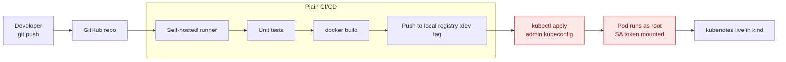
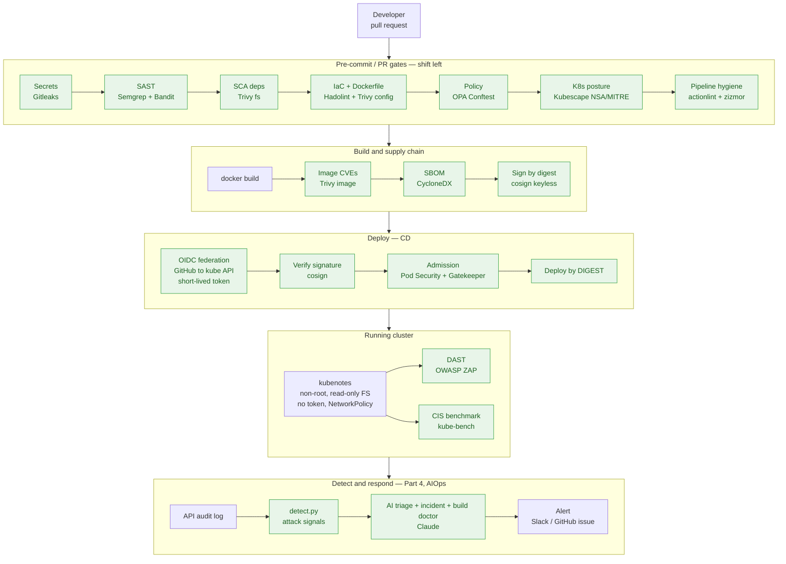
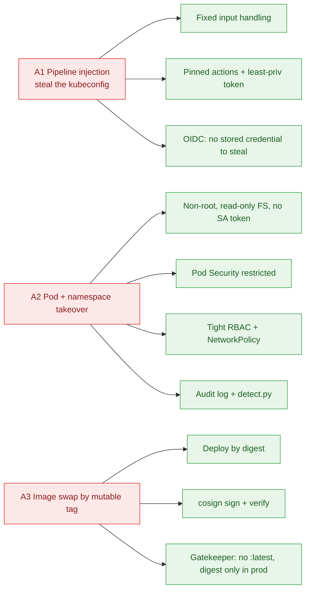

# Pipeline architecture — from plain CI/CD to full DevSecOps

This track builds a pipeline in two states:

1. **The beginning** — a plain CI/CD pipeline (Part 1). It ships code. It has no
   security gates, and Part 2 walks straight through it.
2. **The final** — a standard DevSecOps pipeline (Part 3 + 4). Every stage has a
   gate, identity is short-lived, artifacts are immutable and signed, the
   cluster is benchmarked, and what gets through is detected and triaged by AI.

GitHub renders the Mermaid diagrams below.

---

## 1. The beginning — a plain CI/CD pipeline (Part 1)

**What it gets right:** reproducible build, a registry as the artifact store, an
automated deploy on every push.

**What it gets wrong (the red marks — Part 2's targets):**

- the runner executes untrusted input on your machine (command injection),
- the credential is a long-lived, all-powerful admin kubeconfig,
- nothing scans code, dependencies, image, or manifests,
- the pod runs as root with a powerful ServiceAccount token inside it,
- images deploy by a **mutable tag**, so "what's running" can change silently.

---

## 2. The final — a standard DevSecOps pipeline (Part 3 + 4)

Every box below is a real gate in this repo — a `make` target the pipeline runs,
so "passed locally" means "passes in CI".

### The stages, the tools, and the standard each maps to

| Stage | Gate in this repo | `make` target | Standard / framework |
|-------|-------------------|---------------|----------------------|
| Secrets | Gitleaks | `scan-secrets` | — |
| SAST | Semgrep + Bandit | `scan-sast` | OWASP ASVS, CWE |
| SCA (deps) | Trivy fs | `scan-deps` | CVE / NVD |
| IaC + Dockerfile | Hadolint + Trivy config | `scan-iac` | CIS Docker Benchmark |
| Policy (shift-left) | OPA Conftest | `policy-test`, `scan-iac` | your org policy as code |
| **K8s config posture** | **Kubescape** | **`scan-config`** | **NSA-CISA, MITRE ATT&CK** |
| Pipeline hygiene | actionlint + zizmor | `scan-workflows` | OWASP CICD-SEC |
| Image CVEs | Trivy image | `scan-image` | CVE / NVD |
| SBOM | Trivy CycloneDX | `sbom` | CycloneDX, SLSA provenance |
| Sign / verify | cosign (keyless) | `ci/sign.sh`, `ci/verify.sh` | Sigstore, SLSA |
| Identity | GitHub OIDC → kube API | `oidc` | OAuth2 / OIDC federation |
| Admission | Pod Security + Gatekeeper | `gatekeeper` | Pod Security Standards |
| **DAST** | **OWASP ZAP baseline** | **`dast`** | **OWASP Top 10** |
| **Cluster benchmark** | **kube-bench** | **`cis`** | **CIS Kubernetes Benchmark** |
| Detection | audit log → detect.py | `detect` | MITRE ATT&CK for Containers |
| AIOps | Claude build/triage/incident | `triage`, `incident`, `ai-doctor` | — |

---

## 3. Defence in depth — each attack meets more than one control

The design never relies on a single gate. If one fails, the next catches it.

---

## Where the newer pieces sit

- **Kubescape (`make scan-config`)** runs in CI, with no cluster. It scans the
  Kubernetes **manifests** (code/config) against the NSA-CISA and MITRE
  frameworks and fails the build below a compliance score. This is the
  shift-left twin of admission control: catch a weak manifest in the PR, not at
  deploy time. Point it at `k8s/base` (hardened, passes) vs `k8s/insecure`
  (fails) to see the difference.
- **kube-bench (`make cis`)** runs against the **live cluster** as a Job and
  scores the node and control-plane against the **CIS Kubernetes Benchmark**.
  kind is not a hardened distro, so it reports real gaps — that is the point:
  a benchmark measures distance from a standard so you can close it.
- **OWASP ZAP (`make dast`)** runs against the **running** app in `dev` or
  `prod` after deploy — dynamic testing, the complement to all the static scans
  above it.

Static scans read the code; the benchmark reads the cluster; DAST exercises the
running app; detection reads what actually happened. Together they are
defence in depth across the whole lifecycle.
